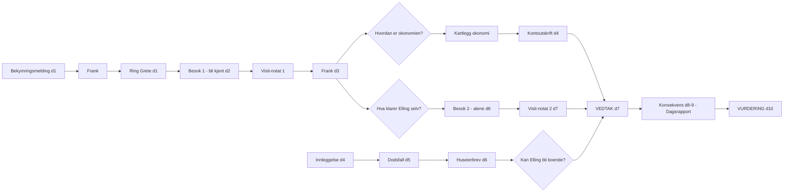

# Golden path replan — session handoff (2026-09-01)

Read this first next session. It replaces the machine-local memory from the 2026-09-01 session.
The same content is in the Obsidian vault as `Lifelines - Golden Path Replan` (Specs). The work plan
with definitions of done is in Things 3, project "Lifelines · golden path replan" (26 to-dos).

## Where Terje is

- One year of Lifelines development done. DD-115 finish line (blind playthrough by end of August 2026)
  passed with the game not done. A few months remain.
- The core-loop repo is a stack of prototypes. The copy reads like an LLM wrote it. Terje will
  rewrite the manuscript from scratch on a new spine.
- Terje is drawing the golden path in Whimsical (accepts pasted mermaid and tables). He plans best
  from a concrete storyline (node diagram) plus UI wireframes. Big inventories overwhelm him.
- Rule he set: **a mechanic stays only if it has a node on the golden path.** "Complexity is the enemy
  right now, unless it pays the price of admission."

## How to work with him on this (learned this session)

- Read `../lifelines-core-loop/AGENTS.md` and use the `pm` CLI (`pm list decision`, `pm list issue`,
  `pm project`, `pm get <id>`) before opining. He flagged missing context once. `pm get` prints JSON
  plus term footnotes, so parse with grep, not json.load.
- GAP tickets go stale. Grep the code before ranking one (GAP-042 was closed by SB-561 in code).
- `prototypes/blueprint_v1.html` is the main proven artifact but **not the golden standard**. Its
  action resource does not work well, and parts of it break in contact with the sim. Use it as raw
  material.
- Do not file DDs or SDDs from opinions. Everything below is opinion until he rules.

## Open question that gates the next step

**What broke when blueprint_v1 met the sim?** Terje said some mechanics break in contact with the
sim but did not say which. The answer decides whether the event trigger table keys on
sim-observable state or on authored stages. Ask this first.

## Current direction (opinions, not rulings)

- Time model: **time as the cost of action, "the action is the day."** A visit or a kartlegg takes
  the day (paper next morning). Desk work (read, lift, call, talk to Frank, vedtak) is free and
  unlimited. The day ends when Frank has done his one thing or on Avslutt dagen. No hours pool, no
  action counter (rejected), no real-time clock, no timeline HUD, no speed tiers. The sim runs the
  day headless over spent days (DD-109). Scripted events fire on a **trigger table**: progress
  condition + floor day + ceiling day.
- Visit shows things, the Visit-notat reads people. No visit without a brief (BESØK with no active
  Oppdrag routes into the Frank call at the brief step).
- Fact to Frank gives the question. Drop combine-two-facts.
- Show Elling's skill levels from day 1. Mystery lives in the people, not the numbers.
- Cut tillit as a resource for the slice. Author door and phone opening per visit.
- Thoughts: icons above heads only, TANKER page hidden.
- No new repo before strangers have played.
- SB-583 (first document starts no chain) is the real day-1 hole. Fix it in the rewrite.

## Next session, in order

1. Ask what broke against the sim.
2. If he has written page 1 (ten-day storyline), walk the repo against it and produce the repo side
   of the cut list (mechanic, screen, content item: cut / hide / keep).
3. If he wants the probe: fork nothing blindly. Build a ten-day HTML page with "the action is the
   day" and the trigger table, Olsen paper verbatim from
   `../lifelines-core-loop/resources/cases/olsen/source/tiny_olsen_slice.json`.

---

## Full vault note (copied verbatim)

## Why this note exists

One year of development on [[Lifelines]] has passed. The finish line in DD-115 (blind playthrough by end of August 2026) has passed with the game not done. A few months remain. The repo is a stack of prototypes and the copy reads like an LLM wrote it. Decision from the 2026-09-01 session with Claude: step back, draw the golden path, and let the path decide which mechanics, screens and content stay. Rewrite the manuscript from scratch on that spine.

The rule: **a mechanic stays only if it has a node on the golden path.** Complexity is the enemy unless it pays the price of admission.

The work plan lives in Things 3, project "Lifelines · golden path replan". Order: storyline, loops, cards, screens, then cut. Storyline before loops, loops before cards, cards before screens, screens before cutting.

## Opinions recorded (not rulings)

- Is the core loop boring, or is the juice missing? Unknown until the case has real prose and no input lag. In this genre the prose is the juice ([[Cultist Simulator]], Papers Please). The manuscript rewrite is the experiment, not a side task.
- Do not start a new repo now. Freeze and trim. Rebuild clean only after strangers have played.
- The sim-casework seam is already designed (DD-109, DD-112, DD-114). The dissonance is unfinished bridges, not superfluous mechanics.
- Visit shows things, the Visit-notat reads people. Make that split explicit and the confusing visit stops promising what the diorama cannot show.
- No visit without a brief. BESØK with no active Oppdrag routes into the Frank call at the brief step. Nobody should see the spine-only fallback visit.
- Fact to Frank gives the question. Drop combine-two-facts. The chain shrinks from five steps to three.
- Show Elling's skill levels from day 1. DD-098 says deduction that pulls the player into puzzle-solver headspace is mistuned. Keep the mystery in the people, not the numbers.
- Cut tillit as a resource for the slice. Author the door and phone opening per visit.
- GAP-042 is stale. SB-561 wired the Oppdrag chain (frank_conversation.gd:446, phone_panel.gd:719/798). Close it.
- SB-583 is the real day-1 hole: the first document must lift a fact that starts the chain.

## Golden path (draft, with the missing end drawn)

## Storyline skeleton (from day_script_beats plus the missing end)

| Day | Beat |
|---|---|
| 1 | Bekymringsmelding lands. Lift. Frank. Ring Grete. Feltnotat. |
| 2 | Besøk 1, bli kjent. Visit-notat 1. Grete blir sliten. |
| 3 | Frank: two questions, one becomes Kartlegg økonomi. Grete ringte ikke tilbake. |
| 4 | Kontoutskrift lands. Innleggelse. |
| 5 | Dødsfall. Beskjed gjennom brevsprekken. |
| 6 | Huseierbrev. Kan Elling bli boende? Besøk 2, alene. |
| 7 | Visit-notat 2 (unwritten). Vedtak. |
| 8 | Dagsrapport: did what I ordered happen? |
| 9 | Dagsrapport. Last chance to adjust. |
| 10 | Vurdering. TRUE read vs MISREAD. Ungraded. Ends with a question. |

Days 7 to 10 do not exist in the pack. That is the writing gap.

## Card inventory, curated to the path (43 rows, trim to 25 to 35)

| Day | Node              | Type      | Id               | Label                                                | Feeds                                                  |
| --- | ----------------- | --------- | ---------------- | ---------------------------------------------------- | ------------------------------------------------------ |
| 1   | Bekymringsmelding | doc       | doc_bekymring    | Dr. Haug melder bekymring                            | f_grete_syk, f_saarbar, f_grete_baerer                 |
| 1   | fact              | fact      | f_grete_syk      | Grete er alvorlig syk                                | q_grete_dor                                            |
| 1   | fact              | fact      | f_saarbar        | Elling er sarbar ved bortfall                        | Frank                                                  |
| 1   | fact              | fact      | f_grete_baerer   | Grete baerer rutinene, omfang ukjent                 | Ring Grete                                             |
| 1   | Frank             | talk      | frank_1          | Fakta til Frank gir sporsmal og oppdrag              | Ring Grete                                             |
| 1   | Ring Grete        | call      | call_grete       | Grete svarer i telefonen, fakta loftes live          | f_klarer_seg, f_ingen_plan, f_elling_tlf, f_grete_redd |
| 1   | fact              | fact      | f_klarer_seg     | Han klarer seg (sagt to ganger)                      | q_grete_dor                                            |
| 1   | fact              | fact      | f_ingen_plan     | Ingen overtakelsesplan                               | q_evner                                                |
| 1   | fact              | fact      | f_elling_tlf     | Elling tar ikke telefonen                            | Besok                                                  |
| 1   | fact              | fact      | f_grete_redd     | Grete er redd noen tar ham                           | Frank                                                  |
| 2   | Besok 1           | visit     | oppdrag_tillit   | Bli kjent. Player watches objects and positions      | Visit-notat 1                                          |
| 2   | Visit-notat 1     | doc       | doc_frank_visit  | Frank leser menneskene                               | f_post, f_bok, f_utklipp, f_avstand, f_smart_gutt      |
| 2   | fact              | fact      | f_post           | Uapnet post pa skoskapet                             | q_okonomi                                              |
| 2   | fact              | fact      | f_bok            | Bok med notater i margen                             | q_evner                                                |
| 2   | fact              | fact      | f_utklipp        | Avisutklipp-arkiv, datert                            | q_evner                                                |
| 2   | fact              | fact      | f_avstand        | Holder alltid et mobel imellom                       | Frank                                                  |
| 2   | fact              | fact      | f_smart_gutt     | Han er en smart gutt                                 | q_evner                                                |
| 3   | Frank             | talk      | frank_2          | Sporsmal blir oppdrag                                | q_okonomi, q_evner                                     |
| 3   | question          | question  | q_okonomi        | Regnestykket Olsen: inn, ut, gjennom hvem?           | Kartlegg okonomi                                       |
| 3   | question          | question  | q_evner          | Hva klarer Elling selv?                              | Besok 2                                                |
| 3   | Kartlegg okonomi  | dispatch  | d_konto          | Be om okonomisk oversikt                             | Kontoutskrift                                          |
| 4   | Kontoutskrift     | doc       | doc_konto_elling | Kontoen disponeres av verge. Kort ikke utstedt       | f_alt_via_grete, f_trygd, f_husleie                    |
| 4   | fact              | fact      | f_alt_via_grete  | Alt gar gjennom Grete                                | Vedtak                                                 |
| 4   | fact              | fact      | f_husleie        | Husleie betales kontant av Grete                     | q_bolig                                                |
| 4   | Innleggelse       | event doc | doc_innleggelse  | Grete innlagt. Sonnen ikke varslet                   | f_innlagt, f_elling_uvarslet                           |
| 5   | Dodsfall          | event doc | doc_dodsfall     | Beskjed gjennom brevsprekken                         | f_dod, f_brevsprekken                                  |
| 6   | Huseierbrev       | event doc | doc_huseier      | Leien har stoppet. Kommer torsdag                    | f_leie_stoppet, f_huseier_kommer, f_leie_privat        |
| 6   | question          | question  | q_bolig          | Kan Elling bli boende?                               | Vedtak                                                 |
| 6   | Besok 2           | visit     | oppdrag_alene    | Alene. Player watches Elling without Grete           | Visit-notat 2                                          |
| 7   | Visit-notat 2     | doc       | NEW              | Frank leser Elling alene (unwritten)                 | f_dor_glott + new facts                                |
| 7   | fact              | fact      | f_dor_glott      | En dor pa glott                                      | Vedtak                                                 |
| 7   | Vedtak            | decide    | vedtak           | Pick tiltak, pin one fact as begrunnelse             | Konsekvens                                             |
| 7   | tiltak            | tiltak    | t_huseier        | Snakk med huseieren (sikre boligen)                  | ck_restanse                                            |
| 7   | tiltak            | tiltak    | t_hjemmehjelp    | Hjemmehjelp 2x uke, Frank (kanal)                    | ck_omsorgssvikt                                        |
| 7   | tiltak            | tiltak    | t_matlevering    | Matombringing (forutsetter doren)                    | ck_omsorgssvikt                                        |
| 7   | tiltak            | tiltak    | t_forvaltning    | Frivillig forvaltning (trygt, bygger ingenting)      | ck_restanse                                            |
| 7   | tiltak            | tiltak    | t_brev           | Apne ett brev sammen med Frank (vekst)               | vurdering                                              |
| 7   | tiltak            | tiltak    | t_institusjon    | Institusjonsvurdering (the MISREAD trap)             | vurdering                                              |
| 8   | Konsekvens        | sim       | dagsrapport_d8   | 08:00 Day Report: did what I ordered happen?         | Vurdering                                              |
| 8   | clock             | clock     | ck_restanse      | Husleierestanse                                      | Vurdering                                              |
| 8   | clock             | clock     | ck_omsorgssvikt  | Omsorgen svikter                                     | Vurdering                                              |
| 9   | Konsekvens        | sim       | dagsrapport_d9   | Second report, last chance to adjust                 | Vurdering                                              |
| 10  | Vurdering         | end       | vurdering        | TRUE read vs MISREAD, ungraded, ends with a question | END                                                    |

## Cut list (draft)

| Item | Where | Call |
|---|---|---|
| doc_kassalapp, f_ingen_matkjop, f_gap | Olsen pack | Cut. Food chain is off the path |
| Fridge, typed ingredients, shopping chain | SDD-128, DD-129 | Cut from slice |
| Combine two facts into a question | SDD-126, DD-103 | Cut. Fact to Frank gives the question |
| Hypotheses (23) | Olsen pack, DD-106 | Park. Simplest: one pinned fact as begrunnelse |
| q_baering, q_vekst, q_kollaps, q_liv | Olsen pack | Park. q_liv may return as the vurdering prompt |
| t_bostotte, t_dokgjennomgang, t_regning | Olsen pack | Cut for slice |
| ck_overfort, ck_bostotte, ck_selvstendighet, ck_grete | Olsen pack | Cut. Grete timeline is scripted anyway |
| Tillit bars | DD-116, wireframe 2 | Cut. Author the door and phone opening per visit |
| Hidden skills | DD-109 | Change. Show levels from day 1. Mystery lives in the people |
| TANKER page, thought inspect | PLAN-110, SB-505, SB-512 | Hide. Icons above heads stay |
| Frank dagsplan planner, hours pool | PLAN-108, GAP-040 | Cut. "N besok igjen" counter instead |
| Board (begrunnelse pinning) | DD-113 | Fold into the Vedtak screen |
| Kartlegg evner specialist | SB-498 finding | Only if skills stay hidden. Otherwise cut |

## Screen inventory (draft)

| Screen | Verbs | Days |
|---|---|---|
| Desk | open document, open phone, send Frank, advance day | all |
| Document reader | read, lift fact | 1 2 4 5 6 7 |
| Frank call | drop fact, pick Oppdrag, diskuter tiltak | 1 3 6 7 |
| Grete call | listen, lift fact | 1 |
| Room view (visit) | watch, look at object | 2 6 |
| Visit-notat / Day Report | read, lift fact | 2 4 7 8 9 |
| Vedtak | pick tiltak, pin begrunnelse, stamp | 7 |
| Vurdering | read, answer | 10 |
| Time panel | play, pause, speed | all |
| Skill panel (Elling) | read | all |

## Parked questions

- Hidden vs visible skills. Ship visible. Reopen only if the stranger test shows the reveal is missed.
- Tillit as a resource. Ship without.
- Visit budget before day 10 (SB-560). Pick a number, ship a counter.
- Thoughts. Icons only. TANKER page hidden.
- Hypothesis gate (DD-106). Simplest version: one pinned fact as begrunnelse.

## Sources

- lifelines-core-loop: `resources/cases/olsen/source/tiny_olsen_slice.json`, `docs/SHIP-MAP.md`, `docs/ROADMAP.md`
- PM: DD-098, DD-109, DD-112, DD-115, DD-123, DD-126, DD-113, SB-555, SB-498, SB-583, SB-591, GAP-042

## Time model (2026-09-01, opinion)

A day is 14 real minutes at 1x (840 sim minutes, TimeManager). Too long for 1 to 3 actions a day. Do not remove days: they are the deadline (vurdering d10), the visit budget and the paper rhythm. Do not add speed tiers. Make skip the primary verb, per DD-110's own click-a-beat model:

- Desk work is instant. The timeline shows the next known beat. One button, **Neste**, jumps to it. **Neste dag** when nothing is left.
- Watching happens at beats (the visit) at 1x. Skipping is a right (DD-112).
- Time panel becomes: pause, play, Neste, Neste dag. Speed tiers go.
- Visit target: 3 to 5 real minutes, beats 20 to 40 s apart, no idle.
- Session budget: about 35 to 45 minutes for the ten-day case.
- Test with the stranger: does anyone press play between beats? That decides how much of the living sim stays live outside visits.

> [!warning] Correction, same day
> The section above assumes the day script is fixed to days. It is not. Terje: player actions can trigger events (Grete dies after other things have happened). Revised recommendation: **time as the cost of action**. Time moves only when the player spends it (a visit costs a day, a call an hour). The sim runs headless over spent time, paper lands. Script events gate on player progress with a day floor (Grete dies after the player holds q_grete_dor and any visit, or day 6 at the latest). No timeline HUD, no speed tiers, no play/pause. The visit is the only scene where real time runs. Risks: authored deaths read as railroading (gate on progress, not one action), and the living sim loses its watch value (accept it, or one optional 'se innom' verb that spends an hour). Page 1 of the plan becomes a trigger table: when X and at least day N.

## Time as the cost of action, worked (2026-09-01)

**Clock.** Two numbers on the desk: Dag N, Frank: H timer igjen. No hours of the day, no playhead, no speed. Each day gives Frank 6 hours. Desk work costs 0 (read, lift, call, talk, vedtak). Field work costs hours: hjemmebesøk 4, kartlegg økonomi 3, specialist a full day. The day ends on **Avslutt dagen**, never by itself. One visit a day at most. Answers SB-560.

**Spending.** Drop Frank with a brief. The scene plays now at 1x, 3 to 5 real minutes, skippable. The Visit-notat lands when the scene ends. Ordered paper lands next morning (the only delay).

**Avslutt dagen.** (1) Sim runs the day headless with committed tiltak (DD-109). (2) Trigger table evaluated, paper queued. (3) Dag N+1, 08:00: queued paper lands, plus a Day Report only if something unwitnessed happened.

**Trigger table** (replaces day_script_beats). Row: event, progress condition, floor day, ceiling day, effect.

| Event | Fires when | Floor | Ceiling | Effect |
|---|---|---|---|---|
| Grete sliten | visit 1 done | 2 | 3 | Day Report line |
| Grete innlagt | player holds q_grete_dor | 3 | 4 | doc_innleggelse |
| Grete død | innlagt + 1 day | 4 | 5 | doc_dodsfall |
| Huseierbrev | død + 1 day | 5 | 6 | doc_huseier |
| Frank status | no vedtak committed | 8 | 8 | doc_status (idle-path ending) |
| Vurdering | always | 10 | 10 | the ending |

Trigger on a question the player holds, not a step they took, so nobody reads causation. Ceilings keep the idle player on the story. doc_status already exists and becomes the idle ending.

**Ten days.** Fast player: ~35 min, TRUE read possible. Idle player: ~5 min, status letter day 8, MISREAD day 10.

**Sim's job.** Consequence over spent days. Apartment = visit stage only. Optional later verb: se innom, 1 hour, live apartment for two minutes. Build only if the stranger misses it.

**Removes.** Real-time desk ticking, timeline HUD (SDD-096), speed tiers, night fast-forward, dagsplan planner. **Needs.** Hours pool (exists, GAP-040), trigger evaluator with a condition field, Avslutt dagen (= next_day_requested).

**Probe.** Track F. Extend Mike's SB-498 HTML probe (day boundary + hour budget already there) to ten days with this table and the Olsen paper. One afternoon. Question: does spending hours feel like agency or like a board game?

> [!tip] Relation to blueprint_v1.html (design-lab prototypes/, the proven artifact)
> Blueprint v1 already runs time as the cost of action: `actions: 2` per day, dispatch costs 1 action, Avslutt dagen is the only clock, paper lands via `pending` with delay 0 or 1 day, `greteStage` 1..5 is a stage counter that every dispatch `avail` reads. Deltas from the worked section: (1) **retract hours, use 2 flat actions** as proven; add weights only if a probe shows the choice is too flat. (2) **SCRIPT keyed by condition + floor + ceiling instead of by day**; the stage counter stays. The Godot build dropped the action budget and the sole-clock day (SDD-096 real-time day, timeline, speed tiers), which is the regression behind the 14-minute day.
> **Probe:** fork blueprint_v1.html, swap SCRIPT to condition-gated, extend day 8 to day 10 with a vurdering, play it. One session.

> [!warning] Correction to the blueprint callout (Terje, same day)
> blueprint_v1 is not the golden standard. Its mechanics work in isolation. The **action resource does not work well** and some parts **break in contact with the sim**. Retract 'use 2 flat actions as proven'. Candidate instead: **no resource, the action is the day.** A visit or a kartlegg takes the day (paper tomorrow). Desk work is free and unlimited. The day ends when Frank has done his one thing, or on Avslutt dagen. Scarcity = ten days, one field action each. A dispatch is what Frank does inside the sim's day (DD-111, visit director), so the sim needs no counter. Open: what exactly broke against the sim; that decides whether the trigger table keys on sim-observable state or on authored stages.
